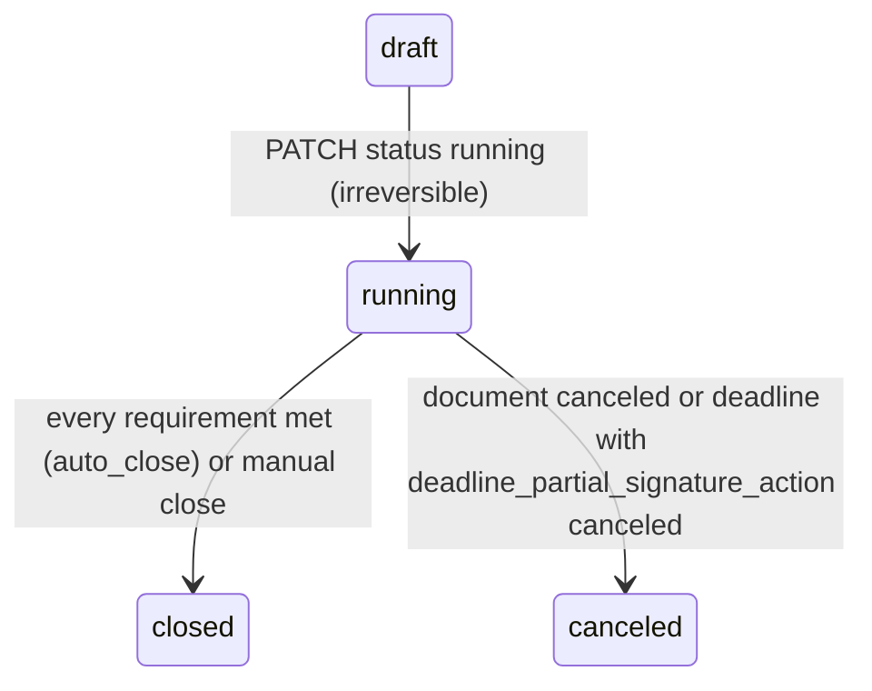

# Concepts: the Envelope model (API 3.0)

Sources: https://developers.clicksign.com/docs/introducao-assinatura-digital.md, https://developers.clicksign.com/docs/envelope.md, https://developers.clicksign.com/docs/ambientes-autenticacao-e-formato.md, https://developers.clicksign.com/docs/informacoes-gerais.md

## Scope: the Envelope API only

`developers.clicksign.com` documents several products on different hosts: the Envelope API (`sandbox.clicksign.com` / `app.clicksign.com`, `/api/v3`), ClickFlow (a no-code journey orchestrator built on top of the Envelope API), ClickForm (a data-collection module), and the Módulo de Aceite e de Notificação (a separate product, authenticated with `X-API-Key`/`X-API-Secret`, not the Envelope access token). This skill only builds Envelope API integrations. If the developer actually wants one of the other products, say that it is a different product with its own setup and stop.

## Glossary

- **Envelope**: the compartment that groups documents, signers and requirements as one transaction. Settings (deadline, reminders, closing behaviour) live here, not on the document.
- **Document**: the file to sign, added to an envelope. It carries no signer logic; that lives in requirements.
- **Signer**: a person added to an envelope and connected to documents through requirements. It cannot be edited after creation.
- **Requirement**: connects one signer to one document. Two kinds matter for a minimal flow: **qualification** (`action: agree`, a `role` such as `sign` or `contractor`) and **authentication** (`action: provide_evidence`, an `auth` such as `email`). A third, optional kind is **rubric** (`action: rubricate`).
- **Evidence**: what a signer produces to satisfy a requirement.
- **Notification**: the message sent to a signer asking them to act.

## Transport

Every request carries:

```http
Authorization: {{CLICKSIGN_ACCESS_TOKEN}}
Content-Type: application/vnd.api+json
Accept: application/vnd.api+json
```

The token goes in the `Authorization` header with no `Bearer` prefix. Bodies and responses follow JSON:API: `{"data": {"type": "<plural>", "attributes": {...}, "relationships": {...}}}`, with `data.id` (a UUID) as the resource id. Errors are `{"errors": [{"code", "status", "title", "detail", "source": {"pointer": "/data/attributes/<field>"}}]}`. `503 service_unavailable` on a fresh account means the Envelope API is not yet enabled for it; the documented rule is accounts created from 01/07/2024, and anyone else needs to ask Clicksign support.

Source: https://developers.clicksign.com/docs/mensagens-de-erro.md

## Lifecycle



1. `POST /envelopes`: creates the envelope in `draft`, visible only to the API user.
2. Add documents, signers, and requirements. Requirements go through `/requirements` only while `draft`; a `running` envelope uses `bulk_requirements` instead.
3. `PATCH /envelopes/{id}` with `status: running`: activates. **Irreversible.** The docs also mention an asynchronous activation endpoint (`/envelopes/{id}/activate`), marked as in development; use the `PATCH` above instead.
4. `POST /envelopes/{id}/notifications` (or per signer): sends the signature request. Activation alone does not notify anyone.
5. The envelope becomes `closed` when every requirement is met (with `auto_close`) or when the deadline passes with `deadline_partial_signature_action: closed`; it becomes `canceled` if a document is canceled or the deadline passes with `deadline_partial_signature_action: canceled` and no signatures. Documents close or cancel individually inside a `running` envelope.

Source: https://developers.clicksign.com/docs/guia-de-criacao-o-passo-a-passo-padrao.md, https://developers.clicksign.com/reference/api-editar-envelope.md, https://developers.clicksign.com/docs/ativacao-escala-performatica.md, https://developers.clicksign.com/docs/aproveitamento-de-assinaturas-parciais-em-documentos-expirados.md

## Activation rules

Activation fails unless every signer has at least one authentication requirement and every document has at least one qualification requirement for each signer who signs it. The creation guide also checks that every document carries at least two requirements. Create both, for every document a signer signs: one qualification and at least one authentication for that signer on that document. A signer only signs the documents it has requirements on.

Source: https://developers.clicksign.com/docs/guia-de-criacao-o-passo-a-passo-padrao.md, https://developers.clicksign.com/reference/api-requisitos.md, https://developers.clicksign.com/docs/docs-requisitos.md

## What can change after `running`

| Action | Allowed while `running`? |
|---|---|
| Edit envelope settings (`deadline_at`, `locale`, `auto_close`, `remind_interval`, `block_after_refusal`, `default_message`) | Yes. `default_subject` only in `draft`. |
| Add a document | Not documented; plan documents before activation. |
| Delete envelope or document | No (`403`, only in `draft`). |
| Add a signer | Yes; its requirements must go through `bulk_requirements`. |
| Edit a signer | Never. |
| Delete a signer | Only if it has not started signing. |
| Remove a requirement | A direct delete works only in `draft`; `bulk_requirements` documents `op: remove` with no stated status rule, so confirm it in sandbox before relying on it while `running`. |
| Notify | Only while `running`, for the active `group`. |

Source: https://developers.clicksign.com/reference/envelope-campos-e-regras-de-negocio.md, https://developers.clicksign.com/docs/signatarios.md, https://developers.clicksign.com/reference/api-excluir-envelope.md, https://developers.clicksign.com/reference/api-excluir-documento.md, https://developers.clicksign.com/reference/bulk-requirements.md, https://developers.clicksign.com/reference/api-excluir-signatario.md, https://developers.clicksign.com/docs/notificacoes.md
